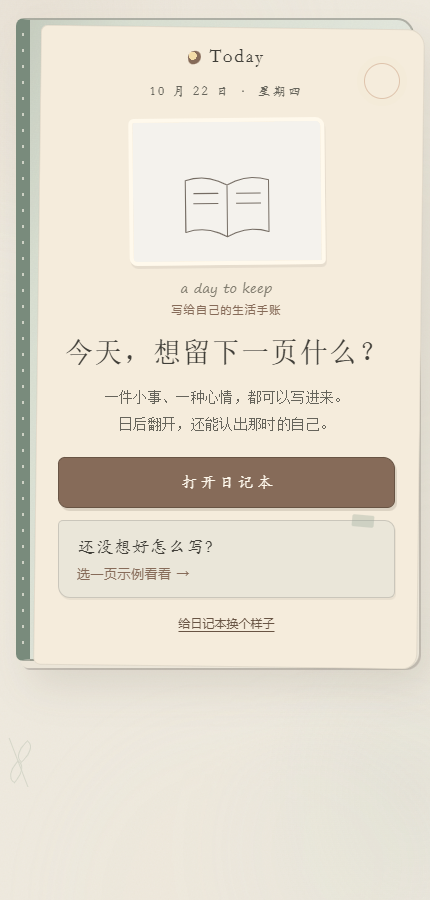
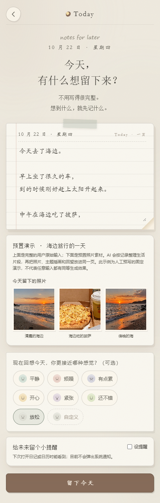
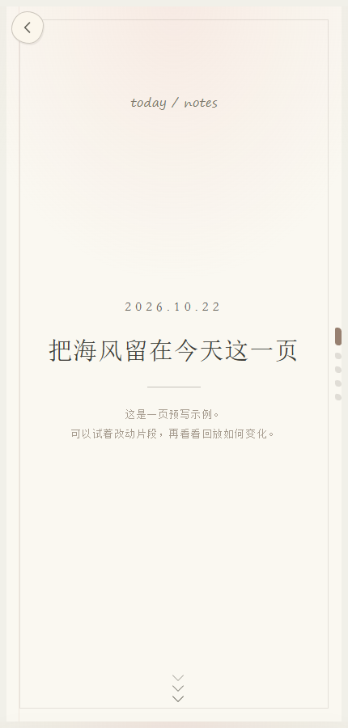
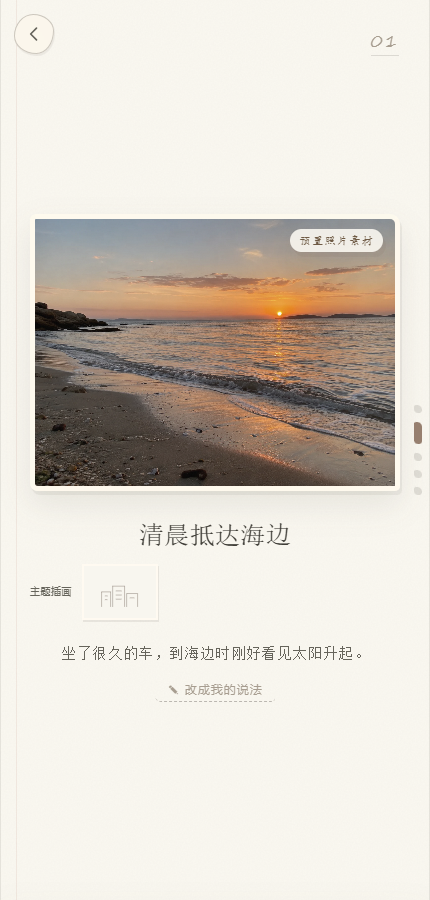

# Today · 一页日记

AI 驱动的生活记忆整理工具。用户写下当天经历、感受并添加照片，Demo 将记录整理为可以翻看的日记回放。

## 在线体验

[打开 Today 交互预览](https://wll-atmioo.github.io/today-ai-journal-demo/)

## 页面预览

以下截图来自公开站点的内置“海边旅行”示例，不包含个人日记。示例文案与照片为预置演示素材。

| 日记首页 | 写下今天 |
| --- | --- |
|  |  |

| 回放封面 | 回放场景 |
| --- | --- |
|  |  |

## 核心流程

用户记录 → Memory Understanding Pipeline → Event → Fragment → Replay

## 当前 Demo 说明

- 本包是纯静态网站。将压缩包内容解压至静态站点根目录，以 `index.html` 为入口；无需构建、后端或 API 密钥。
- 当前使用 Mock AI Provider 验证 AI 产品流程，输出由本地规则与预置示例驱动；未来可以替换为真实 LLM Provider。不要将它视为已接入真实大模型。
- 日记和偏好保存在当前浏览器的 localStorage / IndexedDB 中，不支持账号登录、跨设备同步或服务端备份。清除浏览器站点数据会移除本地记录。
- 建议经静态 HTTP 服务访问（例如在解压目录运行 `python -m http.server 8080`），不要直接双击本地 HTML 文件。
